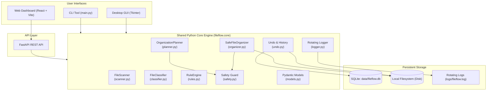

# FileFlow — Smart File Organization System

[](https://www.python.org/)
[](https://docs.pytest.org/)
[](LICENSE)
[]()

> Intelligent, safe, local-first file organization for cluttered folders such as Downloads, Desktop, and Documents. Features dry-run previews, deterministic rule ordering, safety collision safeguards, and persistent undo history.

---

## 1. Project Overview

**FileFlow** is a production-minded file management system built to safely organize chaotic directories without data loss, cloud dependencies, or silent overwrites.

Key principles:
- **Local-First & Private**: Works 100% on your machine. Never uploads file contents to external services.
- **Preview Before Execution**: A mandatory dry-run plan ensures you see every proposed file move before anything touches the disk.
- **Filesystem Safety by Design**: Guardrails against silent overwrites, path traversal attacks (`../`), and modification of protected Windows system folders.
- **Deterministic Rule Engine**: Rules are prioritized in an explicit order with transparent win explanations.
- **Safe Undo & Job History**: Every organization run is saved in SQLite and can be safely reversed without overwriting newer files.
- **Shared Core Engine**: The same Python core services power the CLI, Windows desktop GUI (Tkinter), and Web API (FastAPI + React).

---

## 2. Architecture

FileFlow is engineered with a modular architecture centered around a shared Python core engine:



---

## 3. Technology Stack

- **Core Engine**: Python 3.12+ (tested on Python 3.14)
- **Path & File Handling**: `pathlib`, `shutil`
- **Data Validation & Schemas**: `pydantic>=2.7`
- **Persistence**: `sqlite3`
- **Diagnostics**: `logging` with `RotatingFileHandler`
- **Automated Testing**: `pytest`
- **Desktop UI (Upcoming Phase 2)**: `Tkinter`
- **Web Backend (Upcoming Phase 3)**: `FastAPI`, `Uvicorn`
- **Web Frontend (Upcoming Phase 4)**: `React`, `Vite`, `TypeScript`, `Tailwind CSS`, `Lucide Icons`

---

## 4. Repository Structure

```
File-Organization-System/
├── fileflow/
│   ├── __init__.py
│   └── core/
│       ├── __init__.py          # Shared public API exports
│       ├── models.py            # Pydantic data models & enums
│       ├── logger.py            # Rotating diagnostic log handlers
│       ├── safety.py            # Filesystem safeguards & collision handlers
│       ├── classifier.py        # Smart extension & category classifier
│       ├── rules.py             # Rule engine with default presets
│       ├── scanner.py           # Safe filesystem scanner
│       ├── planner.py           # Dry-run preview planner
│       ├── organizer.py         # Safe execution engine with cancellation
│       └── undo.py              # SQLite job history & safe undo manager
├── core/                        # Root alias forwarding to fileflow.core
├── desktop/                     # Tkinter native desktop application
├── web/
│   ├── backend/                 # FastAPI REST API
│   └── frontend/                # React + Vite dashboard
├── tests/                       # Pytest automated test suite
│   ├── test_classifier.py
│   ├── test_scanner.py
│   ├── test_rules.py
│   ├── test_safety.py
│   ├── test_planner.py
│   ├── test_organizer.py
│   └── test_undo.py
├── scripts/
│   └── generate_samples.py      # Generates realistic sample clutter folders
├── data/                        # SQLite storage directory (.gitignore'd)
├── logs/                        # Rotating log files (.gitignore'd)
├── pytest.ini                   # Pytest path and runner configuration
├── requirements.txt             # Project dependencies
├── .env.example                 # Environment variables template
├── .gitignore                   # Version control exclusions
├── main.py                      # Interactive CLI entrypoint
└── README.md                    # Project documentation
```

---

## 5. Installation & Setup (Windows PowerShell)

### Step 1: Clone or Open Repository
```powershell
cd c:\Users\darkp\Desktop\File-Organization-System
```

### Step 2: Create and Activate Virtual Environment
```powershell
py -m venv .venv
.\.venv\Scripts\Activate.ps1
```

### Step 3: Install Dependencies
```powershell
pip install -r requirements.txt
```

---

## 6. How to Run

### Run Interactive CLI in Dry-Run Preview Mode:
```powershell
.\.venv\Scripts\python.exe main.py
```
*Note: If `sample_files/` does not exist or is empty, FileFlow automatically generates realistic sample files for testing.*

### Execute Organization on a Specific Folder:
```powershell
.\.venv\Scripts\python.exe main.py C:\Users\YourUsername\Downloads --execute
```

### Safely Undo the Most Recent Job:
```powershell
.\.venv\Scripts\python.exe main.py --undo-last
```

### Generate Realistic Sample Clutter Files:
```powershell
.\.venv\Scripts\python.exe scripts/generate_samples.py sample_files
```

---

## 7. Running Automated Tests

Run the complete test suite:
```powershell
.\.venv\Scripts\python.exe -m pytest -v
```

All 34 tests validate:
- Empty folder scans
- Mixed, uppercase, compound, and extensionless files
- Hidden files and symlink isolation
- Collision detection and auto-renaming (`file (1).pdf`)
- Path traversal rejection (`../`)
- Dry-run verification (zero filesystem mutations during planning)
- Preflight revalidation and cancellation support
- SQLite job persistence and safe multi-file undo

---

## 8. Safety & Privacy Model

- **No Silent Overwrites**: When moving a file, FileFlow detects existing files and renames using unique numbered suffixes (`document (1).pdf`), skips, or halts according to policy.
- **Zero Cloud Uploads**: All classification is performed locally via deterministically evaluated rules and extension indices.
- **System Folder Guard**: Prevents selecting root drives (`C:\`) or Windows system directories (`C:\Windows`, `System32`, `Program Files`).
- **Path Traversal Guard**: Strictly resolves and checks that destination paths remain within authorized boundaries.
- **Dry-Run Guarantee**: The planner never moves files or creates target directories as a side effect.
- **Non-Destructive Undo**: Reversing a job checks if the source path is currently free. If occupied, FileFlow refuses to overwrite the existing file.

---

## 9. Implementation Roadmap

- [x] **Phase 1 — Core Engine (Current Milestone)**
  - [x] Project structure and environment setup
  - [x] Category classifier with compound extension handling
  - [x] Filesystem scanner with attribute and permission checks
  - [x] Configurable rule engine with default presets
  - [x] Dry-run preview planner
  - [x] Safe organizer with preflight revalidation and cancellation
  - [x] SQLite job persistence and safe undo system
  - [x] Diagnostic rotating file logging
  - [x] Full automated test suite (34 tests passing)
- [ ] **Phase 2 — Desktop Application (Tkinter GUI)**
  - Folder picker, category summary, preview table, live progress bar, cancellation toggle, and undo controls.
- [ ] **Phase 3 — FastAPI Backend**
  - REST endpoints for scans, previews, job executions, cancellation, and rule management.
- [ ] **Phase 4 — Web Dashboard (React + Vite + Tailwind)**
  - Cybersecurity-inspired dark theme, live job tracking, rules manager, and activity logs.
- [ ] **Phase 5 — Security & Release Packaging**
  - Path sanitization audits, Windows executable packaging.

---

## 10. License

This project is licensed under the MIT License.
